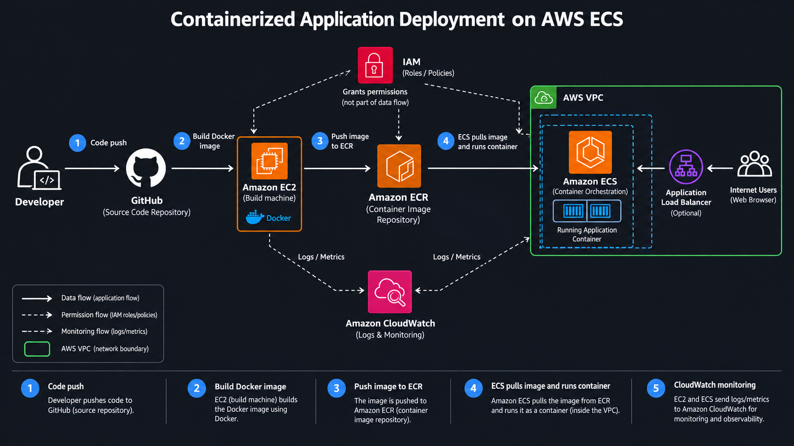

# Deploy a Containerized Application on AWS ECS using Amazon ECR

## 📌 Project Overview

This project demonstrates how to deploy a containerized application on AWS using Docker, Amazon Elastic Container Registry (ECR), and Amazon Elastic Container Service (ECS).

The application source code is stored in GitHub. An Amazon EC2 instance is used as the build machine to build the Docker image and push it to ECR. Amazon ECS retrieves the image from ECR and runs the containerized application. IAM manages access permissions, while Amazon CloudWatch is used for logs and monitoring.

## 🏗️ Architecture Diagram



### Architecture Workflow

1. **GitHub:** Stores the application's source code.
2. **Amazon EC2:** Provides the environment to build the Docker image.
3. **Docker:** Packages the application and its dependencies into a container image.
4. **Amazon ECR:** Stores the container image.
5. **Amazon ECS:** Retrieves the image from ECR and runs the container.
6. **AWS IAM:** Provides the required permissions to AWS resources.
7. **Amazon CloudWatch:** Collects logs and monitoring data.

> The architecture image above is the project diagram included in this repository. Keep `architecture.png` in the repository root so GitHub can display it.

## 🛠️ Technologies Used

| Technology | Purpose |
|---|---|
| GitHub | Source code management |
| Amazon EC2 | Docker image build environment |
| Docker | Application containerization |
| Amazon ECR | Container image registry |
| Amazon ECS | Runs and manages containers |
| AWS IAM | Access control and permissions |
| Amazon CloudWatch | Logs and monitoring |
| Amazon VPC | Networking and isolation |

## ⚙️ Deployment Workflow

1. Store the application code in GitHub.
2. Build the Docker image on the EC2 build machine.
3. Create a private repository in Amazon ECR.
4. Authenticate Docker with ECR, tag the image, and push it to the repository.
5. Configure an ECS cluster, task definition, and service to run the image.
6. Assign the appropriate IAM roles and permissions.
7. Use CloudWatch to review logs and troubleshoot issues.

## 🚀 Deployment Steps

### 1. Clone the Repository

```bash
git clone https://github.com/Bhushan-Sonune/deploy-containerize-app-on-aws-ecs.git
cd deploy-containerize-app-on-aws-ecs
```

### 2. Build the Docker Image

Make sure Docker is installed and the project contains a valid `Dockerfile`.

```bash
docker build -t my-app .
```

Verify the image:

```bash
docker images
```

### 3. Create an Amazon ECR Repository

Create a private repository named `my-app` in the AWS Console, or use the AWS CLI:

```bash
aws ecr create-repository \
  --repository-name my-app \
  --region YOUR_AWS_REGION
```

If the repository already exists, skip this step.

### 4. Authenticate Docker with Amazon ECR

Check the AWS identity configured in your CLI:

```bash
aws sts get-caller-identity
```

Authenticate Docker:

```bash
aws ecr get-login-password \
  --region YOUR_AWS_REGION \
  | docker login \
    --username AWS \
    --password-stdin YOUR_ACCOUNT_ID.dkr.ecr.YOUR_AWS_REGION.amazonaws.com
```

Replace `YOUR_ACCOUNT_ID` and `YOUR_AWS_REGION` with your AWS account ID and region.

### 5. Tag and Push the Docker Image

Tag the image:

```bash
docker tag my-app:latest \
  YOUR_ACCOUNT_ID.dkr.ecr.YOUR_AWS_REGION.amazonaws.com/my-app:latest
```

Push the image to ECR:

```bash
docker push \
  YOUR_ACCOUNT_ID.dkr.ecr.YOUR_AWS_REGION.amazonaws.com/my-app:latest
```

Confirm that the image appears in the ECR repository.

### 6. Deploy the Image Using Amazon ECS

1. Create an ECS cluster.
2. Create a task definition that references your ECR image URI.
3. Configure the container port, CPU, memory, and logging.
4. Choose AWS Fargate or the EC2 launch type.
5. Create an ECS service using the task definition.
6. Configure the VPC, subnets, security groups, and any required public endpoint.
7. Verify that the ECS task reaches the `RUNNING` state.

With **Fargate**, you do not need to manage EC2 worker instances for the ECS tasks. With the **EC2 launch type**, the cluster needs suitable ECS container instances.

### 7. Configure IAM Roles

Use IAM roles with only the permissions each component needs:

- **EC2 build instance role:** Allows the build machine to push images to ECR.
- **ECS task execution role:** Allows ECS to pull private ECR images and send logs to CloudWatch.
- **ECS task role:** Gives the application permission to access other AWS services when required.

Avoid hardcoding AWS access keys in source code.

### 8. Access the Application

After the ECS task is running, use the endpoint configured for your deployment. If you configured an Application Load Balancer, open its DNS name:

```text
http://YOUR-ALB-DNS-NAME
```

Ensure the application listens on the configured container port and the networking, health checks, and security group rules permit the required traffic.

## 📊 Monitoring and Troubleshooting

Use Amazon CloudWatch to inspect application logs and troubleshoot deployment problems.

- **ECR authentication errors:** Check the AWS region, account ID, and IAM permissions.
- **Image pull errors:** Verify the image URI and ECS task execution role.
- **ECS task stops unexpectedly:** Check the stopped reason and CloudWatch logs.
- **Application is inaccessible:** Check container ports, security groups, health checks, and network configuration.

## 🔐 Security Best Practices

- Use IAM roles instead of hardcoding AWS access keys.
- Keep ECR repositories private unless public access is intentional.
- Restrict inbound access to required ports and trusted sources.
- Never commit credentials or secrets to GitHub.
- Use HTTPS for public-facing applications.
- Review IAM permissions and CloudWatch logs regularly.

## 📚 Key Learnings

- Containerizing applications with Docker.
- Building and pushing Docker images to Amazon ECR.
- Deploying containers using Amazon ECS.
- Understanding IAM roles and AWS permissions.
- Configuring AWS networking and security.
- Monitoring application logs with CloudWatch.

## 🔮 Future Enhancements

- Automate image builds and deployments using GitHub Actions.
- Provision AWS infrastructure using Terraform.
- Configure an Application Load Balancer with HTTPS.
- Implement ECS service auto scaling.
- Improve monitoring and deployment health checks.

## 👨‍💻 Author

**Bhushan Sonune**

- GitHub: [Bhushan-Sonune](https://github.com/Bhushan-Sonune)
- Project Repository: [deploy-containerize-app-on-aws-ecs](https://github.com/Bhushan-Sonune/deploy-containerize-app-on-aws-ecs)
